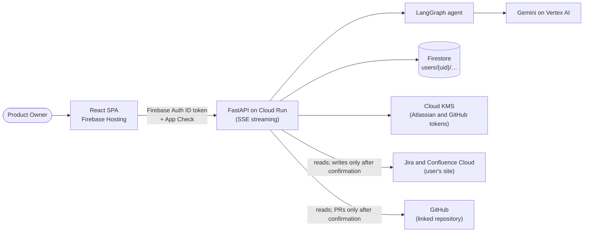

# SpecFlow AI

**Turn a product need into Jira epics, stories and tasks that an AI coding agent can actually ship.**

SpecFlow AI is a chat agent for Product Owners. You describe what you need in your own words; the agent
asks about what is missing instead of inventing it, reads your Confluence docs and your code for context,
and drafts the issue in a fixed, agent-ready format. Nothing is written to Jira, Confluence or GitHub
until you review the proposal and press **Confirm**.

🔗 **App:** https://specsflow-ai.web.app · **Status:** public beta · **Privacy:** https://specsflow-ai.web.app/privacy

---

## What it does

- **Chat with an agent that knows your Jira.** It lists your projects, reads issues and runs JQL to find
  context before proposing anything. A conversation can be pinned to a project, by you or by the agent
  when you name one.
- **Specs written for coding agents.** Every story or task follows the same contract: goal, context,
  acceptance criteria, out of scope, constraints and contracts, where to change, how to verify,
  dependencies and open questions (epics have their own). A deterministic readiness check, with no LLM
  involved, flags what is missing before you send it
  ([ADR-007](docs/modernizacao/adr/ADR-007-spec-pronta-para-agente.md)). Issues are written in
  Portuguese (pt-BR).
- **Human in the loop, enforced in code.** Every write (Jira issues and projects, Confluence pages, GitHub
  pull requests) only produces a *proposed action* card. Execution happens after your confirmation, and
  the payload sent is exactly the one you confirmed
  ([ADR-003](docs/modernizacao/adr/ADR-003-agente-langgraph-acoes-propostas.md)).
- **Edit before you confirm.** Change any section of a proposal on its card, or ask the agent to refine
  one; the agent's version can be restored at any time.
- **Grounded in your Confluence.** Link a Jira project to a Confluence space and the agent reads the
  constitution, business rules, ADRs and glossary before writing a spec, cites the pages it used and warns
  about conflicts. It can also create the project's documentation space and propose page updates, shown as
  a diff ([ADR-009](docs/modernizacao/adr/ADR-009-confluence-como-documentacao.md),
  [methodology](docs/metodologia/README.md)).
- **Knows your code.** Link a GitHub repository to a project and the agent reads `AGENTS.md`/`CLAUDE.md`,
  the file tree and the files that matter, so "where to change" names real paths
  ([ADR-010](docs/modernizacao/adr/ADR-010-github-token-somente-leitura.md)). No code is stored.
- **Specs in your repository.** Export an epic and its stories as `spec.md` and `tasks.md`
  ([Spec Kit](https://github.com/github/spec-kit) format) in a pull request on a new `specflow/*` branch,
  never the default branch; the Jira epic gets a link to the PR
  ([ADR-011](docs/modernizacao/adr/ADR-011-github-escrita-por-pr.md)).
- **Creates Jira projects** (Scrum, Kanban or business) when you ask, after checking the key is free.
- **Persistent conversations** with streaming answers, rename and delete.
- **Created issues history** with live Jira status, *Copy for a coding agent* and *Export to repository*,
  plus a Docs tab with the Confluence pages SpecFlow wrote.
- **Your accounts, your tokens.** Each user connects their own Atlassian site (Jira and Confluence) and,
  optionally, a fine-grained GitHub token; tokens are encrypted with Cloud KMS and never returned or
  logged ([ADR-004](docs/modernizacao/adr/ADR-004-credenciais-jira.md)).
- **Fair use.** Daily quota per user (20 messages / 200k tokens), 10 messages per minute, and Firebase
  App Check in front of the API.

## Architecture



- **Frontend:** React 19 + TypeScript + Vite + Tailwind, TanStack Query. Calls Cloud Run directly because
  chat streams over SSE ([ADR-002](docs/modernizacao/adr/ADR-002-hosting-e-cloud-run.md)).
- **Backend:** FastAPI (Python 3.12) with enforced layering
  `api → services → (agent | integrations | repositories) → core` (import-linter).
- **Agent:** LangGraph with Gemini on Vertex AI, authenticated by the Cloud Run service account; there is
  no LLM API key ([ADR-008](docs/modernizacao/adr/ADR-008-llm-gemini-vertex.md)).
- **Data:** Firestore, backend-only (rules deny every client), everything under `users/{uid}`
  ([ADR-001](docs/modernizacao/adr/ADR-001-firestore.md)).
- **Operations:** structured JSON logs, Cloud Trace, log-based metrics, dashboard, uptime check and SLO,
  all in Terraform.

More detail: [architecture](docs/modernizacao/03-arquitetura.md) ·
[stack](docs/modernizacao/04-stack.md) · [infrastructure](docs/modernizacao/05-infraestrutura.md).

## Repository layout

| Path | What lives there |
|---|---|
| `frontend/` | React SPA, Vitest unit tests, Playwright E2E (`frontend/e2e`) |
| `backend/` | FastAPI app (`app/`), agent, Jira/Confluence/GitHub clients, Firestore repositories, pytest suites |
| `evals/` | Agent evaluation datasets and runner (`evals/run.py`) |
| `infra/terraform/` | All GCP/Firebase resources (Cloud Run, Firestore, KMS, monitoring, App Check) |
| `specs/` | One folder per feature: spec, plan and tasks ([roadmap](specs/ROADMAP.md)) |
| `docs/` | Modernization plan, ADRs, specification methodology, runbooks, API event schema |
| `scripts/` | Deploy, requirement traceability, load test (k6) |
| `legacy/` | The original Streamlit prototype, kept until the go-live clean-up |

## Run it locally

Prerequisites: [uv](https://docs.astral.sh/uv/) 0.11+, Node 22, Docker and make.

```bash
make install   # backend deps (uv) + frontend deps (npm ci)
make dev       # Firebase emulators + API on :8000 + Vite on :5173
```

Open http://localhost:5173, create an account (the Auth emulator UI on http://localhost:4000 shows the
confirmation link) and chat. Locally the agent uses a fake echo model (`LLM_PROVIDER=fake`), so you do
not need Google Cloud credentials. To see every screen filled with sample data, run
`cd frontend && npm run dev:demo`.

Without Docker:

```bash
cd backend && uv run uvicorn app.main:app --reload   # http://localhost:8000/docs
cd frontend && npm run dev
```

## Quality gates

```bash
make lint    # ruff, mypy --strict, import-linter, eslint, prettier, tsc
make test    # pytest (coverage ≥ 80%) + Vitest (coverage ≥ 70%)
make trace   # every functional requirement in specs/ is referenced by a test
make e2e     # Playwright acceptance tests
```

CI (GitHub Actions) runs all of the above plus Firestore rules tests, Terraform validation, gitleaks,
dependency audits and a Docker image check. A manual workflow runs an OWASP ZAP baseline scan against
production.

## How it is built: spec-driven

Every feature starts as a spec with requirement IDs and Gherkin acceptance tests, then a plan and a
task list ([Spec Kit](https://github.com/github/spec-kit)). Tests are tagged with the requirement they
cover, and `make trace` fails CI if an accepted requirement has no test. Non-negotiable rules live in
the [constitution](.specify/memory/constitution.md); decisions are recorded as
[ADRs](docs/modernizacao/adr/). Contribution guide: [CONTRIBUTING.md](CONTRIBUTING.md).

## Deploy and operations

There is a single production environment and no CD pipeline
([ADR-006](docs/modernizacao/adr/ADR-006-deploy-manual-make.md)). `make deploy` builds the image,
starts a no-traffic Cloud Run revision, smoke-tests it, moves traffic and then publishes the SPA. A
failed smoke test moves no traffic. Infrastructure changes go through Terraform in `infra/terraform/`.

Runbooks: [rollback](docs/runbooks/rollback.md) · [all runbooks](docs/runbooks/README.md).

## Roadmap

The full list, with status and dependencies, is in [specs/ROADMAP.md](specs/ROADMAP.md). Already live
after the go-live: Confluence docs (read and write), the proposal editor, pinning the conversation's
project, GitHub repository context, exporting specs as pull requests and creating Jira projects. Next up:
Atlassian OAuth sign-in, continuous agent evals and privacy-friendly analytics.

## Feedback

Found a bug or have an idea? [Open an issue](https://github.com/micaelleos/SpecFlowAI/issues).
